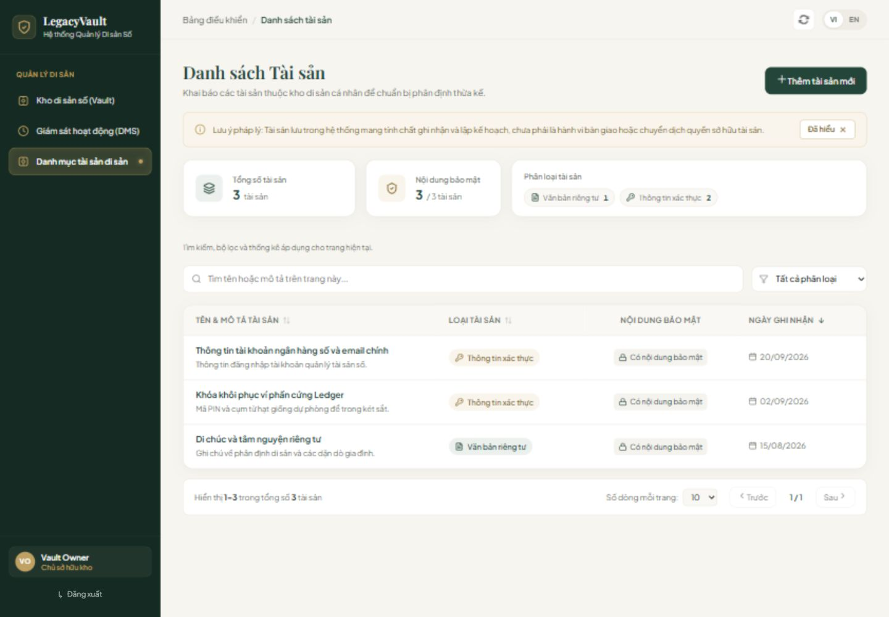
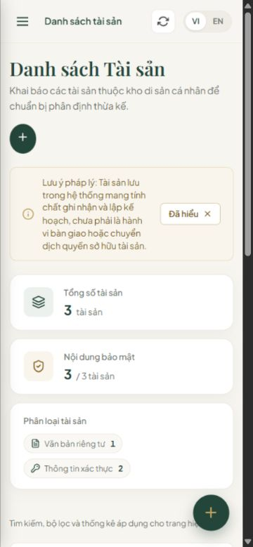

# PS-5 — Bằng chứng bàn giao Frontend

Ngày kiểm tra: 12/10/2026 (Asia/Saigon). Repo nhóm: `Abaddon8386/LegacyVault`.
PR: https://github.com/Abaddon8386/LegacyVault/pull/2, base `develop`, head `feature/PS-5-asset-management`.

## Yêu cầu và phạm vi

Nguồn Jira hiện tại: https://thaithai9785.atlassian.net/browse/PS-5 (đọc ngày kiểm tra).
Add/list Asset thuộc Vault; validation; loading/error; VI/EN; không log secret; client guard không thay authorization Backend.
Lưu Asset chưa phải bàn giao hoặc chuyển quyền sở hữu.

Contract tham chiếu **đề xuất**, chưa được nhóm phê duyệt: `docs/api-contracts/assets.md`, `error-contract.md`,
`open-decisions.md` trên nhánh PS-74, commit 72cbd3281c4d62d4f76b2e3c99771669ec8830ee.
Không đưa nhánh foundation vào PR này. Adapter có thể cần điều chỉnh khi contract được chốt.

| Tiêu chí | Bằng chứng |
|---|---|
| Thêm/list; Asset thuộc Vault | Page nhận `vaultId` từ caller; live adapter không tự thay bằng ID mẫu; request lồng dưới `/vaults/{vaultId}/assets`; kiểm tra metadata thuộc đúng Vault |
| Validation | Tên bắt buộc, tối đa 150; mô tả tối đa 1000; payload bắt buộc; loại TEXT/CREDENTIAL theo bản contract đề xuất; không tự đặt giới hạn payload còn mở |
| Loading/empty/error/retry | Kiểm thử UI và adapter; lỗi phân loại theo code/status, không đưa message kỹ thuật Backend lên UI |
| Pagination | GET đọc envelope `content/page/size/totalElements/totalPages`; page/size/sort gửi về server; search/filter/thống kê ghi rõ chỉ áp dụng trên trang hiện tại |
| VI/EN | Form, validation, thông báo và ngày tháng đổi ngôn ngữ; không refetch chỉ vì đổi ngôn ngữ, không xóa dữ liệu form |
| Payload | Giữ nguyên whitespace người dùng nhập; không có trong response/state danh sách/storage/log; unmount form sau thành công/hủy; giữ form nếu request thất bại |
| Preview/production | Chỉ DEV + `?preview=true`; mẫu chỉ lưu metadata trong memory; giao diện trình bày không hiển thị banner/nhãn kỹ thuật; production chặn route khi chưa có phiên đăng nhập tích hợp |
| Hồi quy | Login vẫn mở được; Vault/DMS/Assets dùng AppShell chung; test điều hướng và guard production |
| Trợ năng | Form focus vào input, trap Tab, Escape/hủy, trả focus về nút mở; khóa hủy/đóng khi POST đang chạy; sort qua bàn phím; nút icon có aria-label |

Theo yêu cầu người dùng ngày 12/10/2026, gỡ banner bản xem trước và thông báo mô phỏng khỏi UI dùng trình bày cho giảng viên/khách hàng. Thông báo thêm tài sản dùng câu trung tính "Đã thêm tài sản vào danh sách"; giới hạn dữ liệu mẫu được ghi trong tài liệu bàn giao.

## Kết quả xác minh

- `npm ci --no-audit --no-fund`: thành công theo package-lock, Node 24.18.0.
- `npm test`: **124/124 PASS** (41 Vitest gồm UI/adapter/định tuyến + 83 Node tests Login/Register/Vault/DMS).
- `npm run lint`: PASS, 0 errors/warnings.
- `npm run build`: PASS.
- Trình duyệt thật cục bộ: desktop 1440×1000, tablet 768×1024, mobile 375×812; Add thành công với dữ liệu kiểm thử,
  modal, VI/EN, drawer mobile và điều hướng Assets → DMS → Vault.
- Production preview cục bộ: `/assets?preview=true` hiển thị fallback, không mở UI hoặc mock khi chưa có auth session tích hợp.
- Review thủ công: diff PS-5, guard/malformed response/payload, CSS scoped tránh tác động form Vault;
  code Login/Vault/DMS và các service/test cũ giữ nguyên so với `develop`.
- SonarQube/Stitch MCP không có công cụ khả dụng trong phiên. Dùng ESLint, test, build và kiểm tra trình duyệt qua CUA/Playwright làm bằng chứng thay thế;
  chưa có kết quả SonarQube để báo cáo.

## Giới hạn tích hợp và quyết định còn mở

Đây là bàn giao UI + adapter FE, **chưa xác minh Add/list thật qua Backend/SQL Server**.
App hiện chưa truyền Vault/session thật vào màn Assets (cũng như các route Vault/DMS đã merge).
Caller tích hợp sau này phải truyền `vaultId` và access token trong memory theo quyết định auth đã phê duyệt;
không lấy ID/quyền sở hữu từ URL hoặc tạo token giả. `/assets` ở DEV không có context sẽ hiển thị dịch vụ chưa sẵn sàng.

PS-74 vẫn In Progress: D-API-04 (token), D-API-06 (pagination), D-API-13 (asset types), D-API-23 (khởi tạo Vault context),
kích thước payload và các quyết định foundation vẫn cần nhóm chốt. Không coi FE guard là bằng chứng ownership/security Backend.
BE integration cần kiểm tra với PS-15: POST 201, GET envelope, validation, 401/403/404/409, ownership và response không chứa payload.

## Kiểm tra lại và rollback

Trong `frontend`: `npm ci`, `npm test`, `npm run lint`, `npm run build`, `npm run dev`.
Mở `/assets?preview=true` để xem mẫu; `/assets` để kiểm tra trạng thái chưa tích hợp, `/login`, `/vault?preview=true`, `/dms?preview=true` để kiểm tra điều hướng.

Không có migration hoặc thay đổi Backend/DB trong PS-5. Khi cần rollback sau merge: revert merge commit của PR #2 trên nhánh riêng,
review lại rồi đưa vào `develop`; giữ các merge PS-1–PS-4. Không reset hoặc force-push `develop`.
