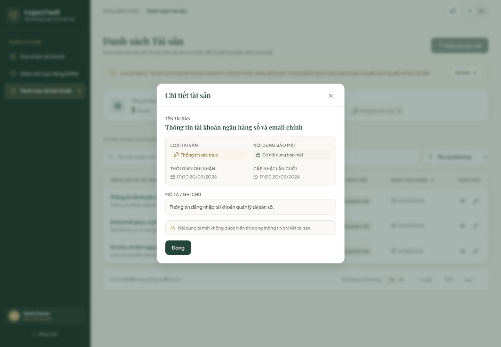
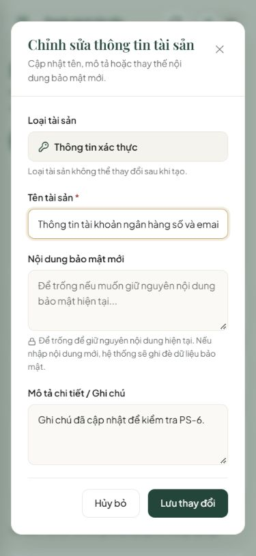

# PS-6 — Bằng chứng chuẩn bị merge

Ngày kiểm tra: 12/10/2026 (Asia/Saigon). Repo nhóm `Abaddon8386/LegacyVault`.
PR: https://github.com/Abaddon8386/LegacyVault/pull/8; nhánh `feature/PS-6-view-edit-asset`; đích `develop`.

## Phụ thuộc và nguồn yêu cầu

**Merge PS-5 (PR #2) trước PS-6.** PS-6 đã cập nhật theo PS-5 commit `e805fc5d58de42bcbdaf5aec8d2c0942aeecc6e8`.
Đây là chuẩn bị PR, chưa phải bằng chứng đã merge hoặc tích hợp Backend thành công.

- Jira PS-6: https://thaithai9785.atlassian.net/browse/PS-6 — detail/edit; lỗi 403/404; refresh dữ liệu; VI/EN;
  Owner chỉ sửa Asset thuộc Vault mình, FE không tự quyết ownership; không log token/secret; focused UI tests.
- PS-16 Backend hiện **To Do** khi đọc ngày kiểm tra: https://thaithai9785.atlassian.net/browse/PS-16.
- Contract PS-74 **đề xuất**, commit 72cbd3281c4d62d4f76b2e3c99771669ec8830ee, `docs/api-contracts/assets.md` và `open-decisions.md`.
  GET detail và PATCH update dùng metadata, chỉ cho sửa name/description/payload; payload không có trong response.
  PATCH là đề xuất D-API-24, chưa phải quyết định đã chốt của nhóm. Giới hạn kích thước payload vẫn chờ chốt.

## Nội dung bàn giao và truy vết

| Tiêu chí | Triển khai và bằng chứng |
|---|---|
| Xem chi tiết | Nút xem trên bảng/thẻ mobile; GET metadata hiện tại, hiển thị tên, loại, mô tả, trạng thái có nội dung, thời gian tạo/cập nhật; không hiện payload |
| Mở sửa | GET chi tiết trước khi mở form, không chỉ lấy dữ liệu cũ trong danh sách; loại và trường hệ thống chỉ đọc |
| PATCH hợp lệ | Chỉ gửi trường đã đổi trong name/description/payload; bỏ payload nếu để trống; giữ nguyên bytes/whitespace của nội dung mới; từ chối patch rỗng hoặc dữ liệu sai |
| Loading/error/403/404 | GET lỗi không fallback sang dữ liệu cached; hiển thị lỗi theo code/status và nút thử lại; update mất quyền/không tìm thấy/không cho sửa đóng phần metadata và bỏ dữ liệu bí mật đang nhập |
| Refresh | Sau PATCH thành công đóng form và tải lại trang danh sách từ service; không tự coi lỗi tải lại là dữ liệu đã được refresh |
| VI/EN | Validation và lỗi theo key, đổi ngôn ngữ không xóa input hoặc refetch; ngày tháng theo locale; giao diện dùng ngôn ngữ sản phẩm, không nhãn thử nghiệm |
| An toàn form | Nội dung cũ không được prefill; form unmount khi đóng/thành công; mạng/server lỗi giữ input để thử lại; chặn gửi trùng, khóa đóng/hủy/Escape khi đang cập nhật; focus/Tab theo modal chung |
| Context và stale response | Kiểm tra đúng id và Vault metadata; abort/ignore request cũ khi đóng modal, đổi Vault/session hoặc rời trang; không hiển thị dialog thuộc context trước |
| Production và storage | Kế thừa guard PS-5: chỉ DEV + preview bật mock, không có ID Vault mẫu trong live mode; mock metadata trong memory, không lưu secret/token vào browser storage |

## Xác minh

- `npm ci --no-audit --no-fund`: PASS (package-lock), Node 24.18.0.
- `npm test`: **159/159 PASS** — 76 Vitest (6 files), 83 Node regression tests Login/Register/Vault/DMS.
- `npm run lint`: PASS, 0 errors/warnings.
- `npm run build`: PASS.
- Browser thật: desktop 1440×1000, tablet 768×1024, mobile 375×812; xem chi tiết, mở sửa, lưu metadata và nội dung kiểm thử,
  xác minh danh sách đổi và payload trống khi mở lại, VI/EN và bố cục bảng/thẻ/modal.
- Review thủ công diff riêng PS-6 so với nhánh PS-5; kiểm tra lỗi quyền, whitelist request/response, context và dữ liệu bí mật.
- Không có SonarQube MCP khả dụng trong phiên; dùng lint, tests, build, review code và CUA/Playwright browser checks làm fallback.
  Không có bằng chứng SonarQube hoặc Backend ownership/SQL Server để báo cáo.

## Giới hạn và cách kiểm tra lại

UI + adapter FE chưa nối phiên đăng nhập/Vault thật trong App; Backend PS-16 chưa được xác minh.
Không coi các test mock/adapters là bằng chứng Spring Security hoặc ownership Backend hoạt động.
PS-74/D-API-04/06/13/23/24 và giới hạn payload cần nhóm chốt; có thể phải cập nhật adapter theo contract chính thức.
Không có thay đổi BE, SQL Server, migration hoặc stack trong PS-6.

Trong `frontend`: `npm ci`, `npm test`, `npm run lint`, `npm run build`, `npm run dev`.
Mở `/assets?preview=true`, dùng nút mắt để xem và nút bút để sửa. Dữ liệu kiểm thử chỉ giữ trong memory, reload sẽ mất thay đổi.

Sau khi PS-5 merge: kiểm tra base/diff PR #8 chỉ còn PS-6, cập nhật `develop` nếu đã có thay đổi mới, chạy lại các kiểm tra liên quan,
nhận review Approve hợp lệ rồi merge PS-6. Không đưa PS-6 vào nhánh PS-5 bằng nút Merge PR #8.

Rollback sau merge: revert thay đổi PS-6 qua PR riêng vào `develop`, giữ PS-5 và PS-1–PS-4; không reset/force-push nhánh tích hợp.
