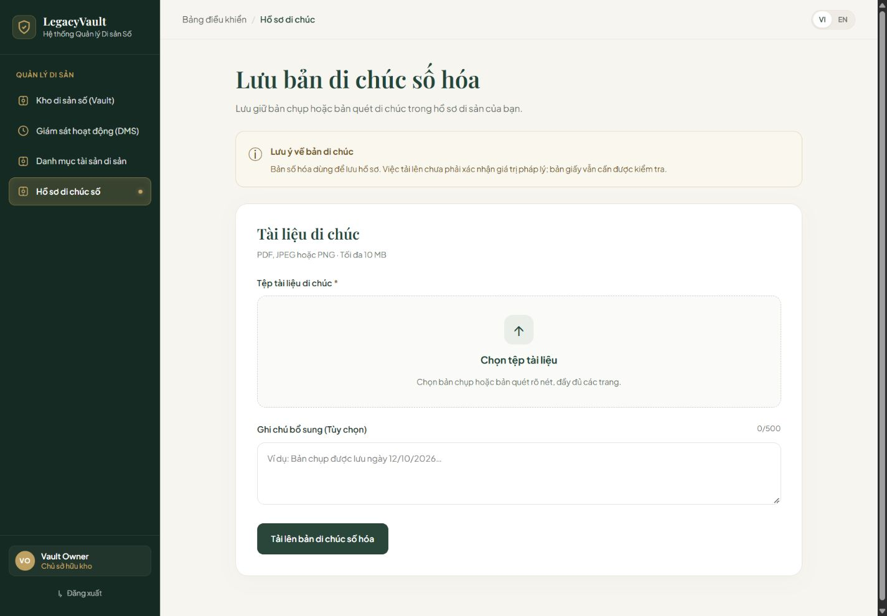
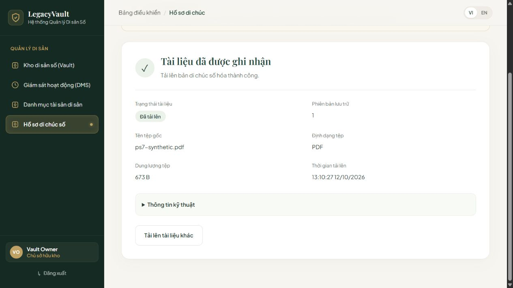
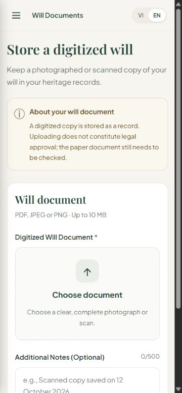

# PS-7 — Bằng chứng chuẩn bị review FE upload di chúc

Ngày kiểm tra: 12/10/2026. Repo nhóm: `Abaddon8386/LegacyVault`, base `develop`.
PR: https://github.com/Abaddon8386/LegacyVault/pull/9
Nhánh: `feature/PS-7-upload-will`. Giữ commit gốc của Huy `a835af75e4653a0161f56fdbdd2d3f169700bc36` và tích hợp develop tại `e25788c7d7e77df37900af5cb3af015de6ceeefd` (PS-6 / PR #8 đã merge).
Không sửa repo backup, BE, SQL Server hoặc cơ chế xác thực.

## Nguồn yêu cầu và quyết định còn mở

Đọc trực tiếp Jira PS-7 và PS-17 ngày 12/10/2026 (mô tả, AC, DoD, trạng thái và liên kết; PS-7 không có comment/attachment/issue link tại thời điểm đọc).

- [PS-7](https://thaithai9785.atlassian.net/browse/PS-7): upload có progress, metadata/hash nếu có, trạng thái UPLOADED; LV-WILL-001 quy định bản số hóa không tự trở thành Legal Approved, bản giấy vẫn phải kiểm tra. Jira đã ở Done trước công việc này; trạng thái đó không phải bằng chứng PR đã merge.
- [PS-17](https://thaithai9785.atlassian.net/browse/PS-17): BE upload vẫn To Do khi đọc. FE guard không thay thế BE ownership, kiểm tra magic bytes, storage, audit hoặc authorization.
- Tham khảo **đề xuất** PS-74 tại commit `72cbd3281c4d62d4f76b2e3c99771669ec8830ee`, `docs/api-contracts/wills.md` trên nhánh `feature/PS-74-api-contracts-foundation`. Đây không phải contract đã được phê duyệt.
- D-API-14 (định dạng/kích thước/lưu trữ/download), D-API-04 (session/token), D-API-23 (Vault context) còn cần chốt khi tích hợp thật. Giữ giới hạn UX PDF/JPEG/PNG, 10 MiB, ghi chú 500 ký tự từ bản FE của Huy và đề xuất; không tuyên bố đó là quyết định BE đã chốt.
- Jira yêu cầu hash **nếu có**: receipt hợp lệ không có hash vẫn hiển thị metadata, không sinh hash thay thế. Khi có hash phải là 64 ký tự hex thường. Cần thống nhất lại điều này với đề xuất PS-74 yêu cầu hash.

## Thay đổi và truy vết

| Yêu cầu | Thực hiện | Bằng chứng |
| --- | --- | --- |
| Upload + tiến trình | XHR multipart, tiến trình byte thật; tối đa 99% trước receipt 201 hợp lệ; tiến trình không xác định khi chưa có tổng byte | Service test, UI progress/duplicate test |
| UPLOADED, không Legal Approved | Kiểm tra receipt UUID/Vault, status, version 1, tên/type/size/date; không chấp nhận LEGAL_APPROVED | Service malformed/status tests, ảnh success |
| Metadata và hash nếu có | Chỉ trả field metadata được cho phép; hash thật từ bytes trong DEV preview; sửa lỗi hash Uint8Array/Buffer slice | Known SHA-256 vector, byte-offset test, PDF tổng hợp |
| Guard và lỗi an toàn | Không mặc định mock; preview chỉ DEV + explicit flag hoặc Node test cô lập. PROD luôn chặn mock. Live cần Vault UUID, token qua props trong bộ nhớ, Accept-Language. Không đưa lỗi backend thô lên UI | Production/default-live, HTTP, HTML/JSON tests |
| UX Việt/Anh | Shell và switch ngôn ngữ chung; lỗi đổi ngôn ngữ theo key, giữ input khi lỗi | App routing test, component tests, mobile EN |
| Dữ liệu riêng tư | Không local/session storage, không log nội dung, không file content view/download; bỏ file/note khỏi form sau thành công | Storage test, whitelist test, browser console không có lỗi |
| Rời trang/chuyển kho/hủy | Abort, chống submit lặp, không nhận callback của phiên/kho cũ; timeout/hủy không khẳng định tài liệu đã bị xóa ở server | Component stale/unmount/cancel và service abort/timeout tests |
| UI thầy/khách hàng | Không banner preview/mock hoặc toolbar kỹ thuật; chỉ giữ lưu ý nghiệp vụ, SHA-256 trong mục mở rộng | Ảnh desktop/mobile |

## Kiểm thử thực tế

Tại frontend trên phiên bản cuối:

- `npm.cmd test`: **229/229 pass** — 116 Vitest (8 files), 113 Node tests. Bao gồm hồi quy PS-1 đến PS-6 và PS-7.
- `npm.cmd run lint`: pass, 0 lỗi/cảnh báo.
- `npm.cmd run build`: pass.
- `git diff --cached origin/develop --check`: pass cho phạm vi PR (không sửa whitespace đã có trên develop).
- Chưa có bằng chứng SonarQube hoặc CI từ các kiểm thử cục bộ này; không coi local pass là CI pass.

Kiểm tra trình duyệt thật tại localhost 5180:

1. Desktop 1440×1000: form VI, chọn PDF tổng hợp, ghi chú, upload hiển thị pending và khóa sửa/submit, nhận success metadata, mở SHA-256.
2. PDF tổng hợp 673 bytes không chứa dữ liệu cá nhân hoặc di chúc thật. SHA-256 tính độc lập bằng Python là `497d0a7cac6a9c08296e74c62b7fcb9a38b8b7c089eaafb1448e82c85f770f5f`, trùng UI.
3. Chọn tải tài liệu khác: file/note được xóa khỏi form. Chuyển EN dùng cùng shell.
4. Mobile 375×812 và tablet 768×1024 không tràn ngang; lỗi thiếu file chuyển đúng VI/EN.
5. Mở `/wills` không có preview, chọn PDF và gửi: báo chưa thể kết nối, không giả upload thành công khi chưa có Vault context.
6. Không có console error trong lượt kiểm tra. Đã trả viewport về mặc định.

## Giới hạn bàn giao và rollback

Đây là PR **FE để review**, chưa là bản upload production hoàn chỉnh. Auth/Vault context chưa nối trong App; protected routes giữ DEV gate của develop. Preview chỉ giữ metadata trong bộ nhớ, không upload/lưu file lên backend. Chưa kiểm chứng E2E PS-17, quyền Owner, lưu trữ, audit hoặc SQL Server. Kiểm tra kiểu/kích thước client chỉ hỗ trợ UX; BE phải kiểm tra file bytes và quyền riêng.

Không triển khai PS-18 (version tiếp theo), không bổ sung download/content preview ngoài PS-7.
Nếu cần rollback sau merge, revert merge commit PR #9 theo quy trình repo nhóm; không revert PS-5/PS-6 và không có migration DB cần rollback.

## Điều chỉnh nội dung theo review của người dùng

- Đổi mục SHA-256 thành **Thông tin kỹ thuật / Technical information**, mặc định thu gọn bằng `details` không có thuộc tính `open`.
- Màn hình kết quả chính giữ trạng thái, phiên bản, tên, định dạng, dung lượng và thời gian tải lên. Hash chỉ xuất hiện khi người dùng mở thông tin kỹ thuật.
- Nhãn và lời giải thích không khẳng định đã kiểm tra toàn vẹn. Mã dùng để so sánh các bản sao khi cần, không xác nhận người lập hoặc giá trị pháp lý.
- Giữ metadata/hash theo AC PS-7, không thay đổi upload/API hoặc tạo chức năng đối chiếu mới.
- Xác minh sau chỉnh sửa: 229/229 tests, lint/build pass; browser xác nhận mục kỹ thuật thu gọn mặc định, mở xem được lời giải thích mới ở cả VI/EN.
