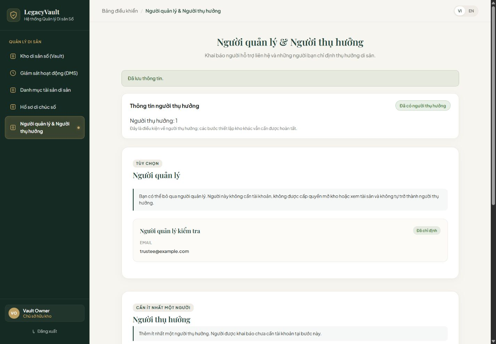
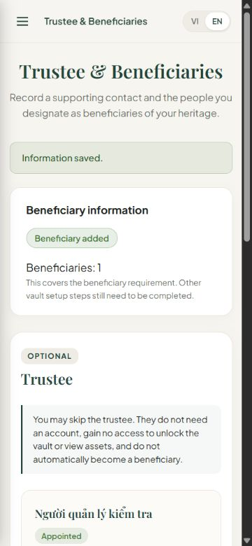

# PS-8 — Khai báo người quản lý và người thụ hưởng

Ngày xác minh: 12/10/2026. Repo nhóm `Abaddon8386/LegacyVault`, nhánh `feature/PS-8-trustee-beneficiary`, PR [#10](https://github.com/Abaddon8386/LegacyVault/pull/10).
Giữ commit gốc của Huy `52e35b3`, tích hợp `develop` tại `4b1c6004747d346e66df345571e71fa4e76585d8` (PR #9 / PS-7 đã merge). Xử lý xung đột App.jsx, không sửa backup, BE hoặc DB.

## Nguồn và giới hạn yêu cầu

Đọc trực tiếp Jira PS-8, PS-19, PS-20 ngày 12/10/2026: description, business rules, AC, DoD, status, links/comments/attachments. PS-8 không có link, comment hoặc attachment khi đọc.

- [PS-8](https://thaithai9785.atlassian.net/browse/PS-8), LV-EXT-001: Trustee tùy chọn, skip/add; không cần account/unlock/decrypt và không tự thành Beneficiary. Beneficiary cần ít nhất một, khai báo không cần account. Không Claim Link/Guest Portal/OTP.
- Jira PS-8 đã ở Done trước lượt kiểm tra; không dùng trạng thái đó làm bằng chứng PR đã merge.
- [PS-19](https://thaithai9785.atlassian.net/browse/PS-19), [PS-20](https://thaithai9785.atlassian.net/browse/PS-20): backend vẫn To Do khi đọc, cần ownership, Spring Security, SQL Server, typed exception, audit/tests theo DoD BE.
- Tham khảo **contract đề xuất** PS-74 tại `72cbd3281c4d62d4f76b2e3c99771669ec8830ee`: `trustees.md`, `beneficiaries.md`, `conventions.md`. Chưa tuyên bố contract đã được nhóm phê duyệt.
- Giữ giới hạn UX/field của Huy và đề xuất: tên 150, quan hệ 100, ghi chú Trustee 500; Trustee cần ít nhất phone/email, tối đa một Trustee hiện hành; Beneficiary phone/email/dateOfBirth tùy chọn. Những chi tiết này vẫn phải thống nhất với BE khi nối thật.
- D-API-04 (session), D-API-06 (pagination), D-API-18 (trustee URL/context), D-API-23 (Vault context) còn cần chốt. Không thêm identityNumber, phân bổ phần chia, quyền giải mã, tạo tài khoản hoặc flow ngoài AC.

## Thay đổi và truy vết

| Yêu cầu / lỗi | Điều chỉnh | Xác minh |
| --- | --- | --- |
| API lỗi tự fallback mock | Bỏ fallback trên GET/POST; default live cần UUID Vault. Mock chỉ DEV + explicit preview hoặc Node test cô lập; PROD luôn chặn mock | POST 401/403/404/409/500, GET forbidden, PROD/clean-mode tests |
| Skip Trustee, không cần account | Skip là trạng thái UI, không gọi endpoint, không xóa Trustee hiện hành. Add ghi nhận APPOINTED, không có userId/quyền/tài khoản | Node tests, component skip, browser thêm Trustee |
| >=1 Beneficiary | Chỉ phản ánh điều kiện người thụ hưởng, không báo toàn Vault/DMS đã sẵn sàng. Không gọi giả API configuration-check | Trustee-only readiness test; browser bỏ qua Trustee rồi thêm Beneficiary |
| Envelope/response | Đọc `content`/`totalElements`, hỗ trợ Xem thêm; whitelist records/requests. UUID/Vault/status/date bắt buộc; creation HTTP 201; Beneficiary DESIGNATED + hasAccount false | Metadata/identity/unsafe-field/status/list/paging tests |
| Lỗi và ngôn ngữ | Shell VI/EN chung, validation theo ngôn ngữ hiện tại, giữ input khi lỗi; lỗi thô server không lên UI | Validation language, HTTP safe messages, browser VI/EN |
| Race/submit | Khóa submit lặp và form khi lưu, AbortSignal khi rời trang/chuyển Vault/token; không nhận late success ở context mới | Component duplicate, stale-context, service aborted-request |
| Ngày sinh | Kiểm tra đúng YYYY-MM-DD và ngày lịch thực, không ở tương lai, dùng ngày hiện tại theo local timezone | Node invalid calendar/leap-date tests |
| UI khách hàng | Không banner mock/preview, nhãn ticket/ST, trạng thái APPOINTED thô hoặc checklist kỹ thuật. Không khẳng định giá trị pháp lý | Browser desktop/mobile screenshots |

## Kiểm tra cục bộ

- `npm.cmd test`: **287/287 pass** — 147 Vitest (10 files), 140 Node tests; gồm hồi quy PS-1 đến PS-7 và PS-8.
- `npm.cmd run lint`: pass, không lỗi/cảnh báo.
- `npm.cmd run build`: pass.
- Diff so với `origin/develop`: không có lỗi whitespace trong phạm vi PR.
- Đây là local checks, không phải bằng chứng CI hoặc SonarQube pass.

Browser QA tại localhost 5182:

1. Bỏ qua rồi mở lại form Trustee; Beneficiary vẫn bắt buộc.
2. Thêm Beneficiary chỉ bằng tên/quan hệ tổng hợp, không phone/email/account: danh sách và count cập nhật, input được xóa sau thành công.
3. Thêm Trustee bằng tên và `trustee@example.com` tổng hợp: chỉ có một record hiện hành, không còn form thêm trùng; không cấp quyền.
4. Desktop 1440×1000; mobile 375×812 EN: không tràn ngang (page width 360, viewport 375), header/nav và nội dung hoạt động. Trả viewport về mặc định.
5. `/people` không preview: báo chưa kết nối khi thiếu Vault context, không hiển thị fake empty/readiness success hay form lưu.
6. Điều hướng từ Assets sang People qua shared shell giữ `preview=true`. Không có console error trong lượt kiểm tra.

## Phạm vi bàn giao và rollback

PR này chuẩn bị review **FE**, chưa là tính năng lưu dữ liệu production hoàn chỉnh. App chưa nối auth/Vault context, protected routes giữ DEV gate hiện có. Chế độ preview tại `/people?preview=true` chỉ giữ dữ liệu trong bộ nhớ module và mất khi reload, không lưu vào backend/browser storage. Không tự fallback sang preview khi mất kết nối.

Chưa có E2E PS-19/20, ownership thật, lưu SQL Server, audit hoặc configuration-check PS-21. Client guard chỉ hỗ trợ UX, không thay BE authorization. Không triển khai sửa/thu hồi Trustee hoặc cập nhật/xóa Beneficiary ngoài PS-8 AC.

Nếu cần rollback sau merge, revert merge commit PR #10 theo quy trình nhóm. Không có migration DB trong PR và không revert PS-7.
